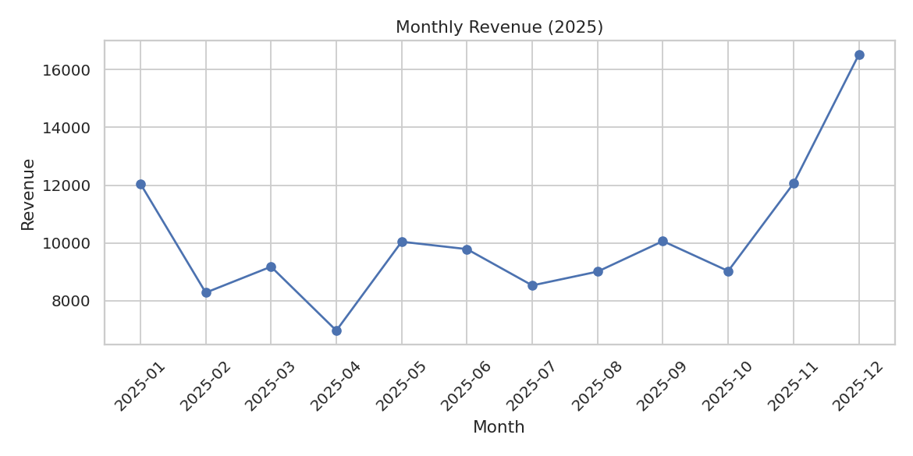
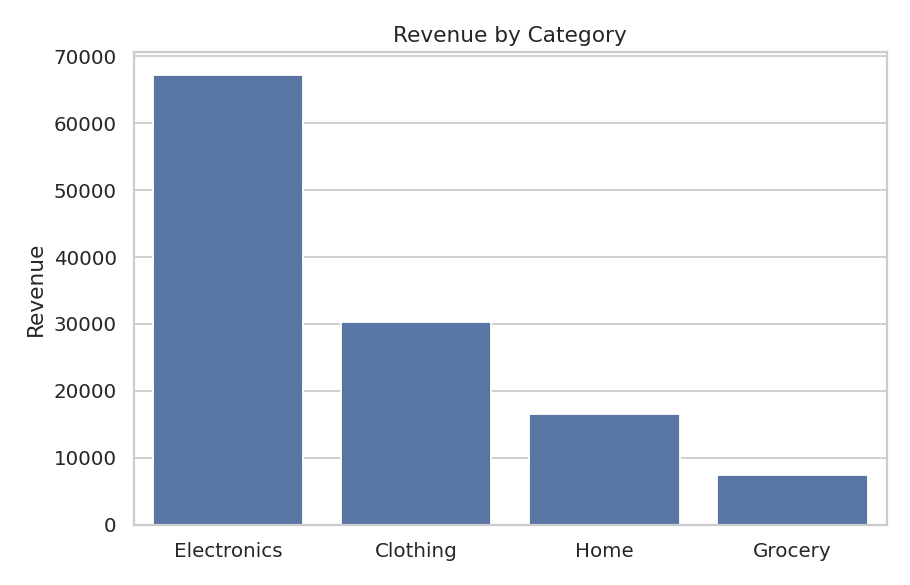
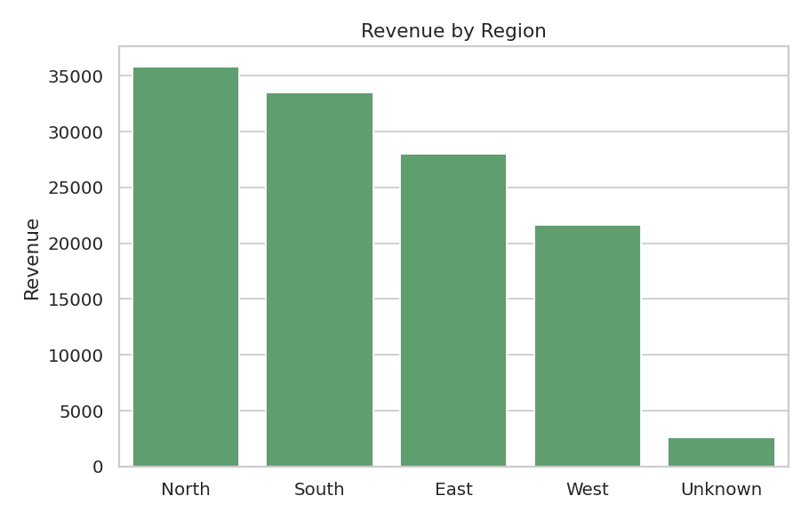
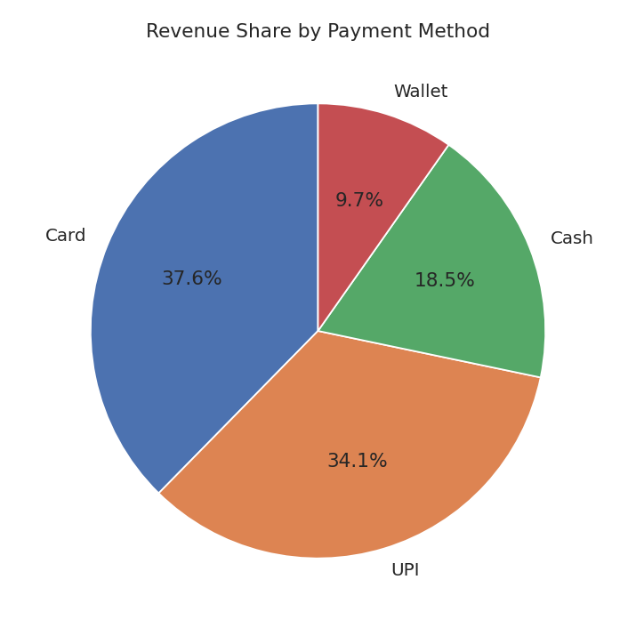
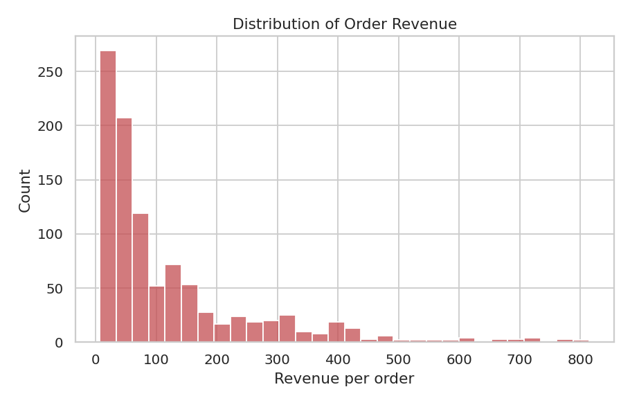
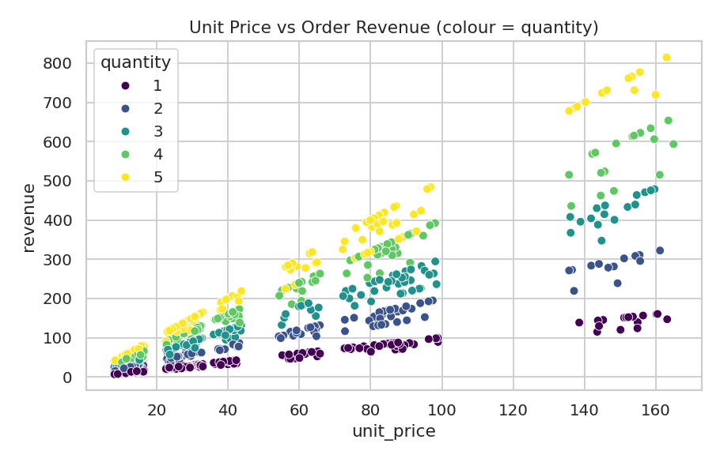

# Retail Sales Analysis Report
*Data: SYNTHETIC practice dataset (generated by src/generate_data.py). Replace with real data before drawing real conclusions.*

## 1. Executive Summary
After cleaning, **992 orders** from **288 customers** generated **121,548** in revenue (average order value **122.53**).
Top category: **Electronics** (55.3% of revenue). Top region: **North** (29.5%).
Peak month: **2025-12** (16,517); lowest month: **2025-04** (6,971).

## 2. Data Understanding
Raw file: **1,025 rows x 10 columns**.

| Column | Type | Meaning |
|---|---|---|
| order_id | int64 | Order number (duplicated rows share the same id) |
| order_date | str | Date of order (text in raw file) |
| customer_id | str | Customer code |
| region | str | Sales region |
| category | str | Product category |
| product | str | Product name |
| quantity | int64 | Units in the order |
| unit_price | float64 | Price per unit |
| discount | float64 | Discount fraction (0.1 = 10%) |
| payment_method | str | How the customer paid |
| revenue (added) | float64 | quantity x unit_price x (1 - discount) |

## 3. Data Quality Findings
Missing values found: {'region': 31, 'discount': 43}. Exact duplicates: 25.

Cleaning log:
- Removed 25 exact duplicate rows.
- Converted order_date from text to datetime.
- Standardised region text (trim spaces, Title Case): 59 values changed.
- Filled 30 missing region values with 'Unknown' (ASSUMPTION: region not recoverable).
- Filled 40 missing discount values with 0 (ASSUMPTION: no discount recorded = none given).
- Removed 3 rows with non-positive unit_price (invalid).
- Removed 5 rows with quantity > 100 (typical range is 1-5; likely entry errors).

Rows: 1,025 raw -> 992 clean. The original file is untouched; the cleaned copy is data/processed/sales_clean.csv.

## 4. Key Metrics
| Metric | Value |
|---|---|
| Total revenue | 121,548.25 |
| Orders | 992 |
| Average order value | 122.53 |
| Unique customers | 288 |
| Share of orders with a discount | 48.6% |

Revenue by category:

| Category | Revenue |
|---|---|
| Electronics | 67,181.27 |
| Clothing | 30,339.50 |
| Home | 16,622.19 |
| Grocery | 7,405.29 |

Revenue by region:

| Region | Revenue |
|---|---|
| North | 35,818.59 |
| South | 33,513.85 |
| East | 27,974.12 |
| West | 21,645.32 |
| Unknown | 2,596.36 |

Top 5 products by revenue:

| Product | Revenue |
|---|---|
| Smartwatch | 33,372.35 |
| Headphones | 21,784.62 |
| Jacket | 17,618.83 |
| Speaker | 12,024.30 |
| Jeans | 8,671.05 |

Top 5 customers by revenue:

| Customer | Revenue |
|---|---|
| C0229 | 1,706.47 |
| C0186 | 1,535.48 |
| C0101 | 1,505.63 |
| C0287 | 1,445.05 |
| C0279 | 1,407.46 |

Descriptive statistics:

|       |   quantity |   unit_price |   discount |   revenue |
|:------|-----------:|-------------:|-----------:|----------:|
| count |     992    |       992    |     992    |    992    |
| mean  |       2.95 |        43.97 |       0.06 |    122.53 |
| std   |       1.43 |        41.02 |       0.07 |    141.08 |
| min   |       1    |         8.11 |       0    |      6.55 |
| 25%   |       2    |        12.88 |       0    |     31.95 |
| 50%   |       3    |        27.02 |       0    |     63.46 |
| 75%   |       4    |        67.42 |       0.1  |    152.24 |
| max   |       5    |       164.87 |       0.2  |    814.95 |

Correlations:

|            |   quantity |   unit_price |   discount |   revenue |
|:-----------|-----------:|-------------:|-----------:|----------:|
| quantity   |       1    |         0    |      -0.02 |      0.42 |
| unit_price |       0    |         1    |       0    |      0.81 |
| discount   |      -0.02 |         0    |       1    |     -0.07 |
| revenue    |       0.42 |         0.81 |      -0.07 |      1    |

## 5. Visualizations
1.  Revenue over time - shows seasonality.
2.  Which categories earn the most.
3.  Regional performance.
4.  Payment preferences.
5.  Shape of order sizes (is it skewed?).
6.  How price and quantity relate to revenue.

## 6. Insights and Recommendations
- **Seasonality:** the last two months of the year account for 23.5% of annual revenue. Plan inventory and promotions ahead of Nov-Dec.
- **Category focus:** Electronics leads and Grocery is lowest. Protect stock of the leader; review pricing or promotion for the laggard.
- **Region gaps:** North vs Unknown shows an uneven spread. Investigate whether the gap comes from customer count, pricing or marketing.
- **Data entry:** quantity outliers, negative prices, duplicates and inconsistent region text all appeared. Add input validation at the source.

## 7. Limitations and Assumptions
- Dataset is synthetic; patterns reflect how it was generated, not a real business.
- Missing discount treated as 0 and missing region as 'Unknown' (assumptions).
- Quantity > 100 treated as error; with real data, confirm with the data owner first.
- One year of data, so year-over-year trends cannot be assessed. Correlation does not imply causation.
